<p align="center"></p>

# Kidney cancer, predicted by machine learning: an analysis in the LSMA Analysis Lab

**Can the genes active in a kidney tumour predict how a patient will fare, and tell a tumour that has already spread from one that has not? And do those predictions still hold for patients the model has never seen?**

This repository is a worked example from the **LSMA Analysis Lab**, the analysis platform of the [London School of Multiomics & AI](https://lsma.co.uk). Two models were built in the lab, without writing code: a **survival model** that ranks patients by risk of death, and a **classifier** that tells metastatic (stage IV) from localised (stage I) tumours. Each was trained on 200 TCGA patients, compared with alternatives by cross-validation, and scored on held-out patients. The trained models were then tested, unchanged, on **200 other TCGA patients**, mostly from other hospitals. The lab's two reports, the figures and the tables are here.

| | |
|---|---|
| **Data** | TCGA-KIRC (The Cancer Genome Atlas, clear cell kidney cancer): RNA-seq gene counts of primary tumours, from the NCI Genomic Data Commons |
| **Patients** | Cohort 1 (training and testing): 200 tumours, 82 deaths. Cohort 2 (validation): 200 different tumours, 45 deaths |
| **Features** | 17,316 expressed genes, as log2 counts per million |
| **Questions** | (1) Survival time, with death as the event. (2) Stage IV against stage I (22 against 93 tumours in cohort 1) |
| **Lab module** | Machine learning (workflow version 1.0.0; scikit-learn and lifelines) |
| **Lab run time** | **20 s** for the survival model, **6 min 6 s** for the stage classifier (six models compared, nested tuning, 100 label shuffles). Importing the 200 tumours from TCGA: 3 min 47 s |
| **Validation** | The frozen models on cohort 2, both models retrained from scratch on cohort 2 (15 s and 2 min 0 s), robustness re-runs with other numbers of genes (20 s and 4 min 26 s), and the published biology |
| **Result** | Both models hold up on new patients: C-index 0.64 and log-rank p = 0.008 for survival, ROC AUC 0.82 for stage. The signal is modest for survival and good for stage, and the genes behind it are known kidney cancer biology |

---

## Biological question and aim

**Question.** Doctors judge the outlook of a kidney cancer mainly from its stage and grade. Does the tumour's gene activity carry this information too? Can a model learn from it which patients are at higher risk, and which tumours have already spread? And, the question that matters most for any model, does it still work on patients it was not trained on?

**Hypothesis.**
- Tumours that keep the genes of normal kidney tubule cells are less aggressive. Their loss should mark higher risk, as in the known ccA (better) and ccB (worse) subtypes of ccRCC.
- Metastatic tumours should divide faster. Cell-division genes should tell stage IV from stage I.
- A model with real signal should keep most of its performance on a second group of patients, while one that has learnt noise should fall to chance.

**Aims**
1. Import 200 TCGA-KIRC tumours into the lab and look at the data before any model.
2. Build a penalised Cox model for survival, and compare six classifiers for stage IV against stage I, choosing genes and settings inside cross-validation only.
3. Score both models once on held-out test patients, and check the classifier against shuffled labels.
4. See which genes the models rely on.
5. Test the frozen models on 200 other patients, retrain them there from scratch, and repeat the training with other numbers of genes.

---

## Background: machine learning on tumour RNA

A tumour sample gives the activity of about 20,000 genes, but a study has a few hundred patients. With far more features than patients, a model can always find genes that happen to fit the training patients by chance. **Machine learning in biology is mostly about not fooling yourself.** The lab therefore builds in the safeguards that published models often skip:

- **A test set is put aside first** (a quarter of the patients) and used only once, at the end.
- **Everything learnt from the data happens inside cross-validation:** choosing genes, scaling them and tuning settings. Choosing genes on all patients first, and cross-validating afterwards, is the commonest error in the field.
- **The label-shuffle test** repeats the whole procedure with the outcome shuffled, to show what score chance alone produces.

Two kinds of model are used here:
- **Survival model.** A *Cox regression* with an elastic-net penalty, which keeps only the genes it needs. Its score, the **concordance index (C-index)**, is the share of patient pairs it ranks correctly: 0.5 is guessing, 1 is perfect, and good clinical models typically reach 0.65 to 0.75.
- **Classifier.** Six models are compared: three forms of logistic regression, a linear support vector machine, a random forest and gradient boosting. Its score is the **ROC AUC**: the chance that a random stage IV tumour gets a higher score than a random stage I tumour.

---

## Key findings

1. **The survival model ranks patients better than chance** (Figures 1–3).
   - **The model is a penalised Cox regression with 17 genes.** On the 50 held-out patients its C-index is 0.66 (95% interval 0.53 to 0.78), close to its cross-validated 0.68.
   - **Patients it calls high risk die sooner** (log-rank p = 0.03): 16 deaths among 29 high-risk patients, against 5 among 21 low-risk patients.
2. **Loss of normal kidney genes means higher risk** (Figure 3).
   - **High expression protects.** The genes with protective weights are genes of healthy kidney tubule cells. *LRP2* (megalin), *SLC6A19*, *ENPP3*, *PCK1*, *SLC22A2* and *CLDN2* belong to the proximal tubule; *TMEM213* and *ATP6V0A4* to the acid-handling cells of the collecting duct. Tumours that keep them are better differentiated.
   - **High expression raises risk.** Antibody genes (*IGHG1*, *IGKC*, from infiltrating plasma cells) and *KRT19*.
   - **This is the same axis as the multi-omics factor.** It matches the kidney-metabolism factor that followed death in the [multi-omics analysis](https://github.com/MultiOmics-Intelligence/lsma-lab-multi-omics-kidney-cancer-tcga-kirc), and the known ccA/ccB split.
3. **Tumour RNA tells metastatic from localised tumours** (Figures 4–8).
   - **The six models tie.** Their cross-validated AUC ranges from 0.74 to 0.83, and the lab warns that none can be told apart from the best (Figure 4). It picked the random forest; the lasso model scored 0.81.
   - **The models learnt real signal.** With shuffled labels, the AUC is 0.52; the real one is 0.83 (permutation p = 0.01; Figure 5).
   - **On the 29 held-out patients the AUC is 0.88** (interval 0.72 to 1.00; Figure 6).
4. **A good AUC is not a good test** (Figures 7–8).
   - **At the default threshold of 0.5 the model finds only 2 of the 6 stage IV tumours** (sensitivity 0.33), while correctly leaving 22 of 23 stage I tumours alone (specificity 0.96).
   - **The model ranks well but is cautious about calling stage IV.** That is expected when stage IV makes up one patient in five. The ROC curve shows that a lower threshold would find more.
5. **Metastatic tumours divide faster and attract T cells** (Figures 9–10).
   - **Cell-division genes come back in every fold.** 54 genes were chosen in all five cross-validation folds. Most are genes of cell division, such as *HJURP*, *MYBL2*, *CDC20*, *TPX2*, *NDC80*, *KIF20A* and *CENPA*, all higher in stage IV.
   - **Kidney genes are higher in stage I.** These include *ALDH1L1*, *PPARA* and *RORC*.
   - **Immune genes follow stage IV.** *XCL1*, *XCL2*, *IFNG* and *TRBV28* are T-cell genes. In ccRCC, unlike most cancers, a T-cell-rich tumour is linked to a worse outcome.

Evidence labels from the lab: cross-validation, test scores and the permutation test are *statistically supported*; the genes the models use are *interpretation*.

---

## Quality control and PCA

| Check | Result |
|---|---|
| Tumours | 200 primary tumours in each cohort, one per patient; no patient in both cohorts |
| Genes | 60,660 in the count files → 17,316 expressed (above 1 count per million in 20% of samples) |
| Diagnoses (cohort 1) | 182 clear cell adenocarcinoma, 14 not reported, 4 renal cell carcinoma NOS; all kept, as TCGA lists them under KIRC |
| Survival data | follow-up and vital status for all 200; median follow-up 3.2 years; 82 deaths |
| Stage (cohort 1) | 93 stage I and 22 stage IV used for the classifier; stage II and III tumours left out |
| Balance | the lab warns that the stage classes are unbalanced (1 to 4) and that balanced accuracy and the ROC curve, not accuracy, should be read |

**PCA before any model (Figure QC2).**
- **Stage IV tumours lean to one side.** Many sit in the upper part of the plot, but the classes overlap, so a model has real work to do.
- **A small group sits far to the right on PC1.** It holds about 10 tumours, mostly stage I. The lab's data check flagged a similar handful of outlying samples in cohort 2. They were kept: the models choose their own genes, and the second cohort tests whether such samples matter.

| | |
|---|---|
| 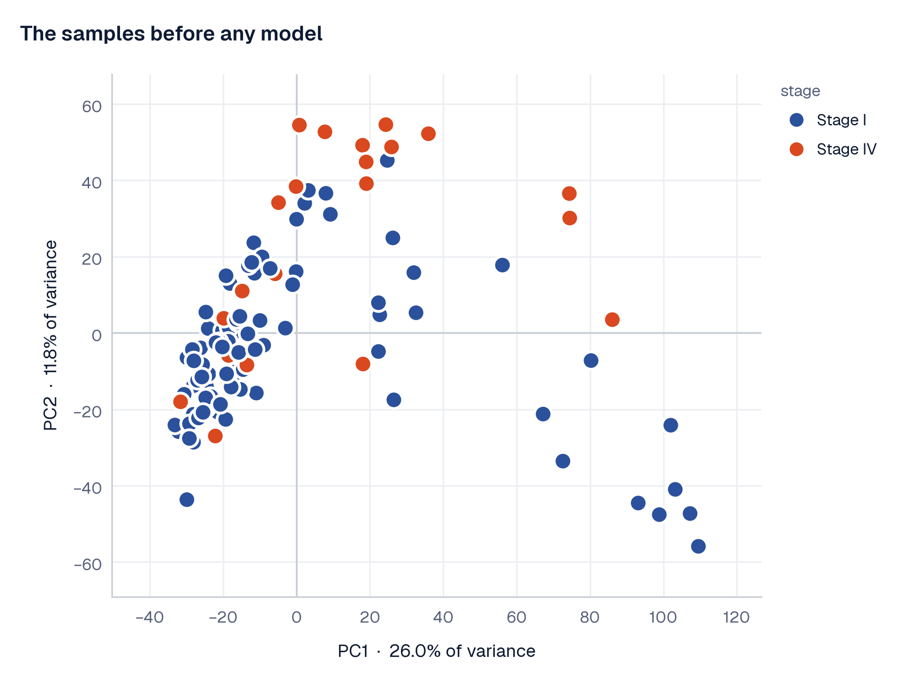 **QC2.** PCA of the 2,000 most variable genes, stage I and stage IV tumours. | 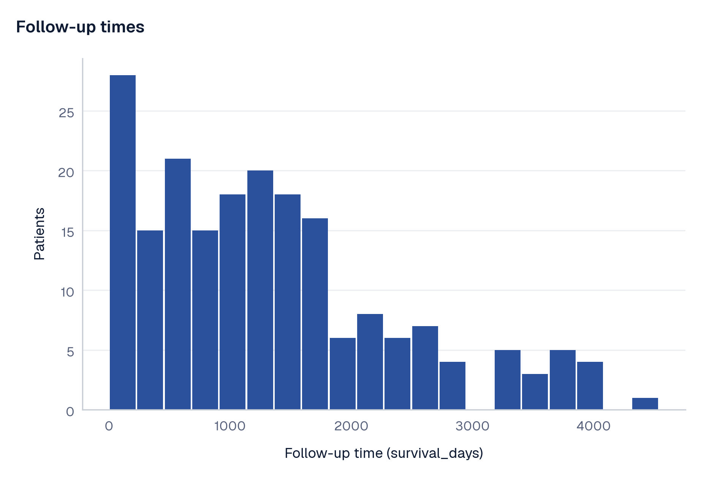 **QC1.** Follow-up times of the 200 patients. |

The PCA of all 200 patients and the class sizes are in [`figures/`](figures).

---

## Figures

| | |
|---|---|
| 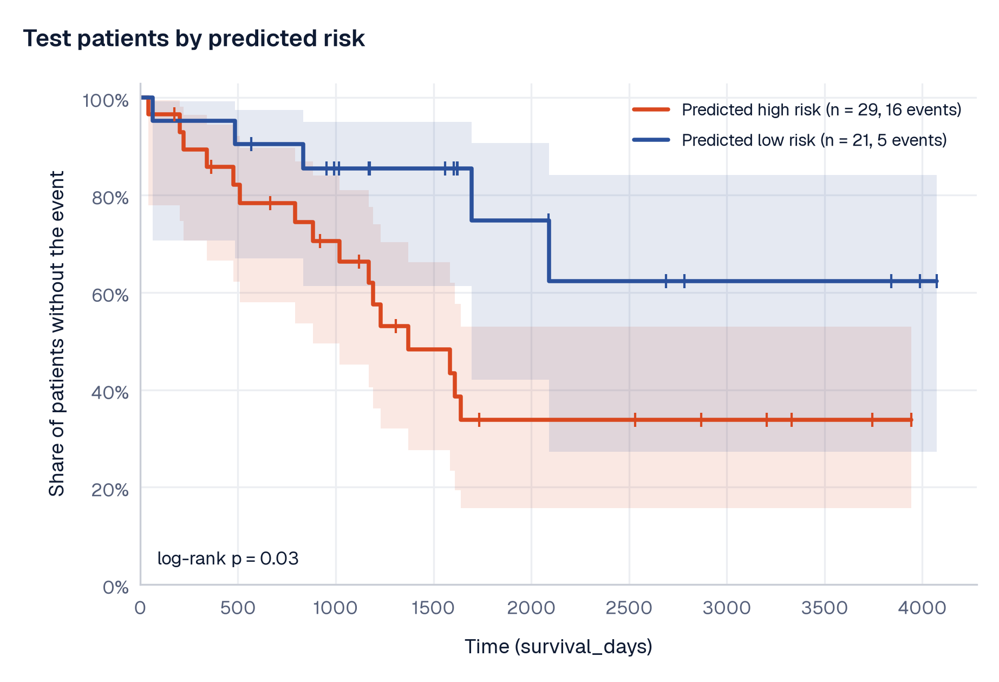 **Figure 2.** Held-out patients split by the survival model's predicted risk (log-rank p = 0.03). | 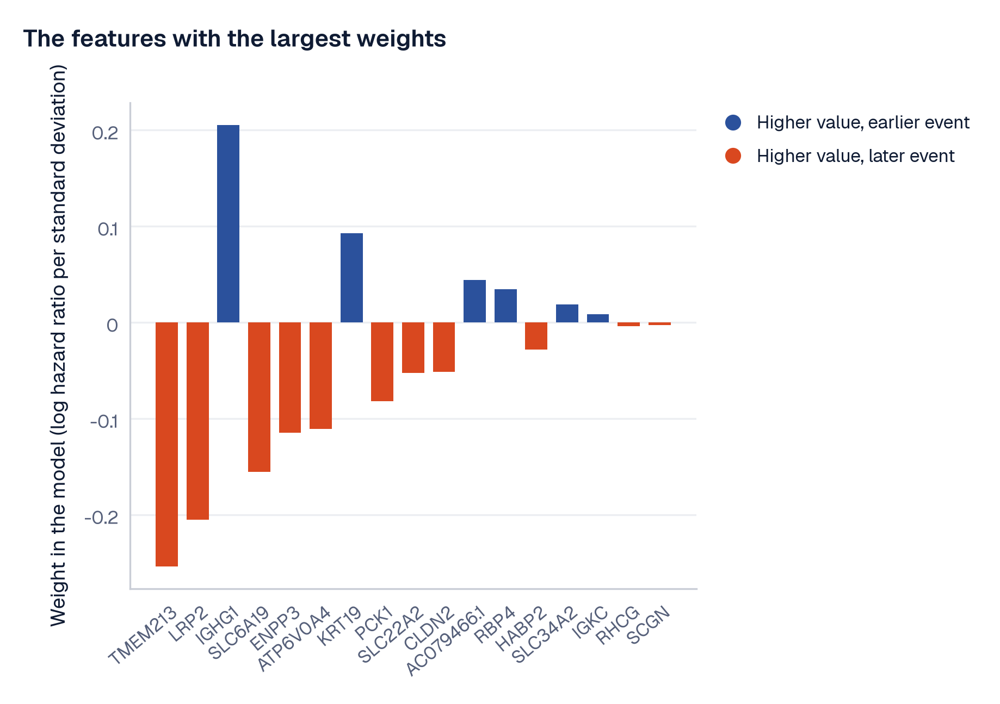 **Figure 3.** The genes of the survival model and their weights. |
| 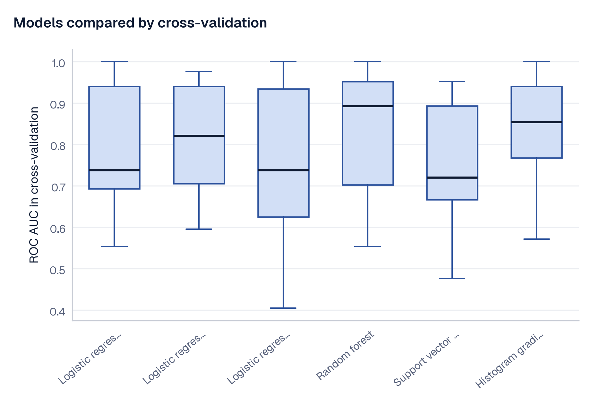 **Figure 4.** Six classifiers compared by cross-validation: they cannot be told apart. | 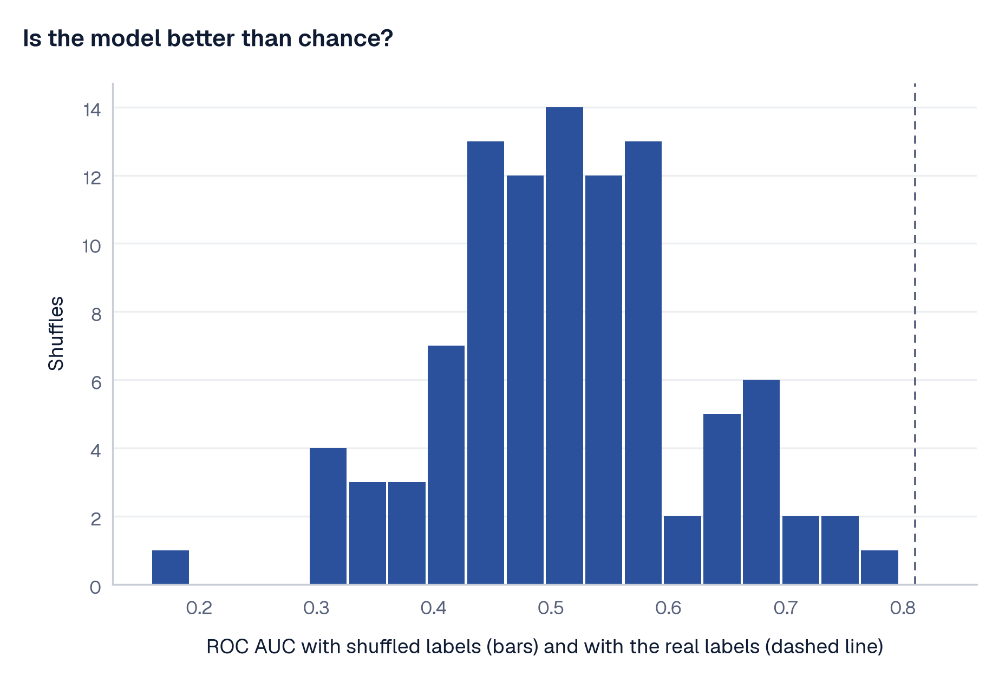 **Figure 5.** The classifier against 100 runs with shuffled labels. |
| 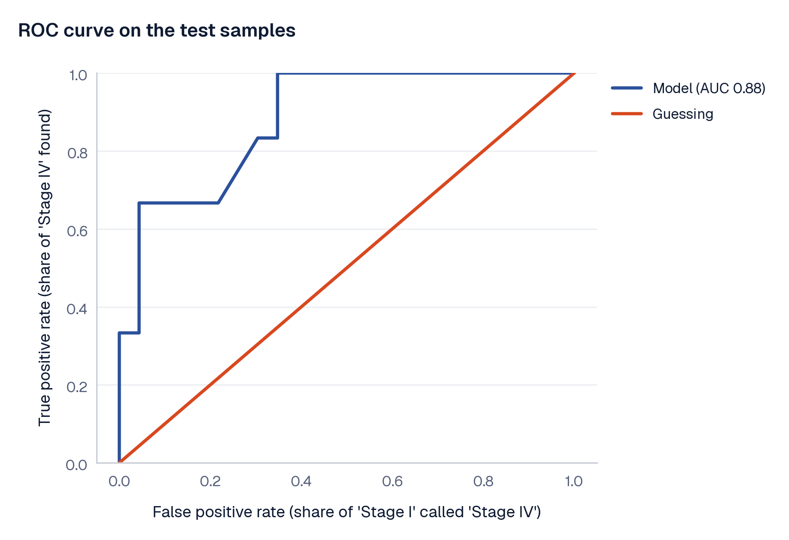 **Figure 6.** ROC curve on the held-out patients (AUC 0.88). | 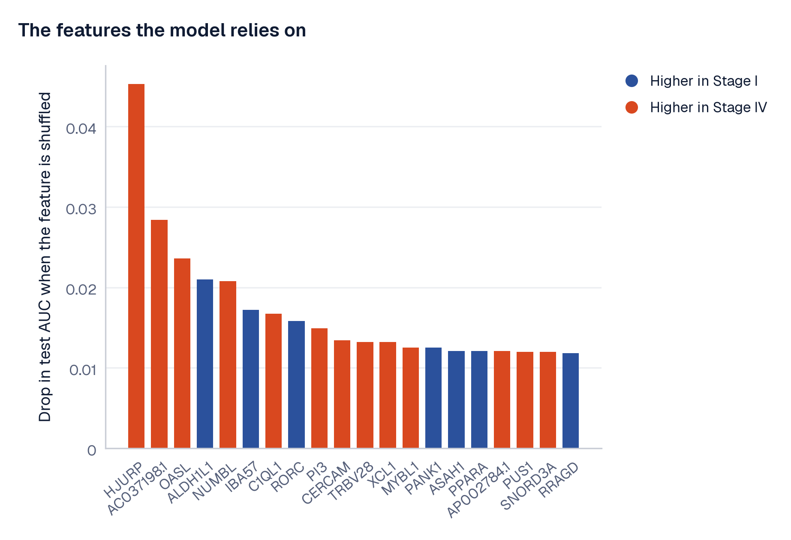 **Figure 9.** The genes the classifier relies on most. |

All figures are in [`figures/`](figures), as PNG (300 dpi) and vector PDF:

| File | What it shows |
|---|---|
| 01 | Survival model: penalty strengths compared by cross-validation |
| 02 | Survival model: held-out patients by predicted risk |
| 03 | Survival model: genes and weights |
| 04 | Stage classifier: six models compared |
| 05 | Stage classifier: real labels against shuffled labels |
| 06 | Stage classifier: ROC curve on the test set |
| 07 | Stage classifier: confusion matrix at threshold 0.5 |
| 08 | Stage classifier: precision and recall |
| 09 | Stage classifier: permutation importance of genes |
| 10 | Stage classifier: expression of the top genes by stage |
| qc-pca-* | Follow-up, class sizes and PCA before any model |

## The full reports

The lab produced one report per model. Each covers every stage: what was done, why, the checks, the results and their limits.
- **Survival model:** [PDF](report/LSMA-Analysis-Lab-report-kidney-cancer-survival-model.pdf) or [HTML](report/LSMA-Analysis-Lab-report-kidney-cancer-survival-model.html)
- **Stage classifier:** [PDF](report/LSMA-Analysis-Lab-report-kidney-cancer-stage-model.pdf) or [HTML](report/LSMA-Analysis-Lab-report-kidney-cancer-stage-model.html)

Download the HTML version and open it in a browser for the interactive figures.

## Summary tables ([`results/`](results))

| File | Contents |
|---|---|
| `survival/model_coefficients.tsv` | The 17 genes of the survival model, with coefficient and hazard ratio per standard deviation |
| `survival/model_comparison.tsv` | Penalty strengths compared by cross-validation |
| `survival/test_metrics.tsv`, `survival/test_predictions.tsv` | C-index with interval, and each test patient's risk score and group |
| `stage/model_comparison.tsv` | The six classifiers: mean AUC, spread, and whether each can be told apart from the best |
| `stage/feature_stability.tsv` | How often each gene was chosen across the cross-validation folds |
| `stage/feature_importance.tsv` | Permutation importance of each gene, and its mean in stage I and stage IV |
| `stage/test_metrics.tsv`, `stage/test_predictions.tsv` | AUC with interval, sensitivity, specificity, and each test patient's probability |
| `*/data_split.tsv` | Which patients were used for training and which for the test |

---

## Workflow

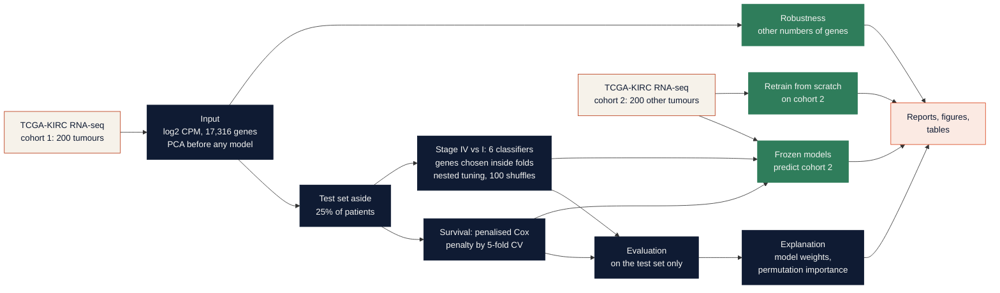

## How it was done

Every step below is a stage in the LSMA Analysis Lab, run with the settings in [`settings/analysis-settings.json`](settings/analysis-settings.json).

1. **Import.** 200 primary tumours of TCGA-KIRC were imported from the Genomic Data Commons (gene counts and the clinical sample sheet), the most the lab takes per sample type.
2. **Input.** Genes above 1 count per million in at least 20% of samples were kept and transformed to log2(CPM + 1). The outcome was taken from the sample sheet:
   - for survival, `survival_days`, with `vital_status` = Dead as the event;
   - for stage, `stage`, with Stage IV as the positive class and Stage I as the negative.
3. **Training.** A quarter of the patients were set aside, stratified by outcome.
   - **Survival model.** A Cox regression with an elastic-net penalty, using the 50 most variable genes of the training patients. The penalty was chosen by 5-fold cross-validation.
   - **Stage classifier.** Six classifiers were compared by 5-fold cross-validation, repeated twice. In every fold, the 200 genes with the largest F statistic were chosen from the training part, and settings were tuned by an inner 3-fold cross-validation. The labels were then shuffled 100 times and the procedure repeated.
4. **Evaluation.** The chosen models, fitted on all training patients, predicted the test patients once. Intervals come from 1,000 bootstrap resamples.
5. **Explanation.**
   - For the survival model: its weights.
   - For the classifier: the fall in AUC when each gene is shuffled among the test patients, 20 times per gene.

**Software:** Python 3.12 with scikit-learn 1.9.1, lifelines 0.30.3, numpy, pandas and scipy, in the versions listed in the settings file.

## The mathematics behind the methods

The formulas below are the ones the lab's code applies (lifelines and scikit-learn), with the settings of this run.

**Features.**

$$
x_{gi} = \log_2\left( \frac{10^6  c_{gi}}{L_i} + 1 \right)
$$

$c_{gi}$ is the count of gene $g$ in tumour $i$ and $L_i$ the tumour's total count. Inside each model, genes are standardised with the mean and standard deviation of the training patients only.

**Penalised Cox model (survival).** The hazard of death is $h(t \mid x) = h_0(t) \exp(\beta^\top x)$, and lifelines finds

$$
\hat{\beta} = \underset{\beta}{\arg\max} \  \ell(\beta) - n \lambda \left( \rho \lVert \beta \rVert_1 + \frac{1 - \rho}{2} \lVert \beta \rVert_2^2 \right), \qquad \ell(\beta) = \sum_{i  :  \delta_i = 1} \left( \beta^\top x_i - \log \sum_{j \in R(t_i)} e^{\beta^\top x_j} \right)
$$

$\ell$ is the log partial likelihood: $\delta_i = 1$ if patient $i$ died, and $R(t_i)$ is the set of patients still followed at that time (lifelines uses Efron's correction when deaths share a time). $n$ is the number of training patients, $\lambda$ the penalizer, chosen from 0.1, 0.5 and 2.0 by 5-fold cross-validation (0.1 won), and $\rho = 0.5$ the l1_ratio. The L1 part pushes weak genes towards zero; lifelines replaces $\lvert \beta \rvert$ by a smooth approximation while fitting. $x$ holds the 50 most variable genes of the training patients. The risk score is $r = \hat{\beta}^\top x$.

**The frozen-model test.** For cohort 2, each gene was standardised with the cohort-1 training mean and standard deviation, and $r = \hat{\beta}^\top x$ was computed with $\hat{\beta}$ unchanged. Patients above the median risk of the cohort-1 training patients were called high risk. Nothing was refitted.

**Concordance index.**

$$
C = \frac{\sum_{i,j} \mathbf{1}[t_i < t_j]  \delta_i \left( \mathbf{1}[r_i > r_j] + \tfrac{1}{2}\mathbf{1}[r_i = r_j] \right)}{\sum_{i,j} \mathbf{1}[t_i < t_j]  \delta_i}
$$

A pair of patients can be compared when the one with the shorter time died. $C$ is the share of such pairs in which that patient had the higher risk score: 0.5 is guessing and 1 a perfect ranking.

**Log-rank test (high against low risk).**

$$
\chi^2 = \frac{\left( \sum_t (O_{1t} - E_{1t}) \right)^2}{\sum_t V_t}, \qquad E_{1t} = d_t \frac{n_{1t}}{n_t}, \qquad V_t = \frac{n_{1t}  n_{2t}  d_t  (n_t - d_t)}{n_t^2  (n_t - 1)}
$$

At each time of death $t$, $n_t$ patients are still followed ($n_{1t}$ and $n_{2t}$ in each group), $d_t$ die, and $O_{1t}$ of the deaths are in the high-risk group. $\chi^2$ is compared with a chi-squared distribution on 1 degree of freedom.

**Gene selection by F statistic (stage).**

$$
F_g = \frac{\sum_{k} n_k \left( \bar{x}_{gk} - \bar{x}_g \right)^2 / (K - 1)}{\sum_{k} \sum_{i \in k} \left( x_{gi} - \bar{x}_{gk} \right)^2 / (N - K)}
$$

The one-way ANOVA F statistic of gene $g$ for $K = 2$ classes (stage IV and stage I) among the $N$ training patients of a fold: the spread between the class means over the spread within classes. The 200 genes with the largest $F_g$ were kept, chosen again inside every fold.

**Penalised logistic regression.** With $y_i = \pm 1$,

$$
\min_{w,  b} \  C \sum_{i} s_i \log\left( 1 + e^{-y_i (w^\top x_i + b)} \right) + \frac{1 - \rho}{2} \lVert w \rVert_2^2 + \rho \lVert w \rVert_1
$$

$\rho = 0$ gives the L2 model, $\rho = 1$ the lasso and $\rho$ of 0.2 or 0.8 the elastic net; $C$ (the inverse penalty strength) was tuned from a small grid by the inner cross-validation. The weights $s_i = N / (2 N_{y_i})$, where $N_{y_i}$ is the size of the class of patient $i$, make the rarer stage IV tumours count as much in total as the stage I tumours. The linear SVM replaces the logistic loss by the hinge loss $\max(0,  1 - y_i (w^\top x_i + b))$ with an L2 penalty.

**Random forest (the chosen model).**

$$
\hat{p}(x) = \frac{1}{B} \sum_{b=1}^{B} \hat{p}_b(x), \qquad G = 1 - \sum_{k} \pi_k^2
$$

Each of $B = 300$ trees is grown on a bootstrap sample of patients, trying $\sqrt{200} \approx 14$ randomly chosen genes at each split and choosing the split that most reduces the Gini impurity $G$ ($`\pi_k`$ is the share of class $k$ in a node, weighted for balance). The forest's probability is the mean over the trees. Gradient boosting instead adds small trees one at a time, each fitted to reduce the logistic loss left by the trees before it.

**ROC AUC and balanced accuracy.**

$$
\text{AUC} = P\left( \hat{p}_{+} > \hat{p}_{-} \right) + \tfrac{1}{2} P\left( \hat{p}_{+} = \hat{p}_{-} \right), \qquad \text{balanced accuracy} = \frac{1}{2} \left( \frac{TP}{TP + FN} + \frac{TN}{TN + FP} \right)
$$

The AUC is the chance that a randomly chosen stage IV tumour gets a higher predicted probability than a randomly chosen stage I tumour. Balanced accuracy is the mean of sensitivity and specificity at a probability threshold of 0.5.

**Permutation test of the classifier.**

$$
p = \frac{b + 1}{B + 1}
$$

The stage labels of the training patients were shuffled $B = 100$ times and the whole procedure (selection, tuning, cross-validation) repeated; $b$ counts the shuffles with a cross-validated AUC at least as high as the real one. With $b = 0$, $p = 1/101 \approx 0.0099$, the smallest value 100 shuffles can give.

**Permutation importance.**

$$
I_g = \text{AUC} - \frac{1}{R} \sum_{r=1}^{R} \text{AUC}^{(g,  r)}
$$

$\text{AUC}^{(g,r)}$ is the test AUC after shuffling gene $g$ among the test patients, repeated $R = 20$ times. A gene the model relies on loses AUC when its link to the patients is broken.

**Bootstrap intervals.**

$$
\left[ \hat{\theta}^{\ast}_{(0.025)},\  \hat{\theta}^{\ast}_{(0.975)} \right]
$$

The test patients were resampled with replacement 1,000 times and the AUC or C-index $\hat{\theta}^{\ast}$ computed on each resample (resamples with only one class, or fewer than two deaths, were skipped). The interval runs from the 2.5th to the 97.5th percentile of these values.

---

## Validation

A held-out part of one dataset is the weakest form of validation; the lab says so in its own report. So the models were tested on a second cohort.

**Cohort 2.** TCGA-KIRC has 533 patients with a primary tumour RNA-seq file, and the lab takes 200 of them in a fixed order. Cohort 2 is **200 different patients**, fetched with the lab's own TCGA importer told to skip the first 200 ([`validation/scripts/fetch_second_cohort.py`](validation/scripts/fetch_second_cohort.py); patient list in [`validation/second_cohort_patients.tsv`](validation/second_cohort_patients.tsv)).
- **Most come from other hospitals.** 193 of the 200 come from three contributing centres with no patients in cohort 1.
- **The cohort is less sick.** It has fewer deaths (45 against 82) and fewer stage IV tumours (9 against 22).

It is from the same consortium, so it is not fully independent, but it is the strongest test available with this outcome data.

### 1. The frozen models on 200 new patients
The models trained in the lab on cohort 1 predicted cohort 2 without any refitting. The genes were measured in cohort 2 exactly as the lab's input stage measures them ([`validation/scripts/apply_frozen_models.py`](validation/scripts/apply_frozen_models.py); results in [`validation/frozen_models_on_second_cohort.tsv`](validation/frozen_models_on_second_cohort.tsv)).

| Model | Cohort 1, held-out test | Cohort 2, frozen model |
|---|---|---|
| Survival, C-index | 0.66 (0.53 to 0.78), 50 patients | **0.64 (0.55 to 0.72)**, 200 patients |
| Survival, high vs low risk | log-rank p = 0.03 | **log-rank p = 0.008** (30 of 101 high-risk patients died, 15 of 99 low-risk) |
| Stage IV vs I, ROC AUC | 0.88 (0.72 to 1.00), 29 patients | **0.82 (0.61 to 0.97)**, 119 patients |

Both models keep most of their performance on patients from other hospitals.
- **The survival model's interval is narrower in cohort 2** (four times as many patients) and lies clearly above 0.5.
- **The stage classifier's interval is wide** because cohort 2 has only 9 stage IV tumours.

### 2. Retrained from scratch on cohort 2
The same lab workflow was run on cohort 2 alone ([`validation/second-cohort-retrained/`](validation/second-cohort-retrained)).
- **Stage: the same biology.** The lasso model reached a cross-validated AUC of 0.87. **13 genes were chosen in every fold in both cohorts:** *AURKB*, *CDC20*, *CDCA3*, *CEP55*, *HJURP*, *KIF18B*, *KIF2C*, *MYBL2*, *SKA1* and *UBE2C* (cell division), *IFNG* and *LTA* (T cells), and *MELTF*. Its test AUC of 0.95 rests on only 2 stage IV test patients and means little.
- **Survival: a warning about small data.** With only 45 deaths, the retrained model's test C-index was 0.46, no better than guessing (11 deaths among the 50 test patients). Two of its 10 genes are on the Y chromosome (*RPS4Y1*, *USP9Y*), so part of what it learnt was the patients' sex. The frozen cohort-1 model, trained with nearly twice as many deaths, did much better on the same patients. Events, not patients, limit a survival model.

### 3. Robustness: other numbers of genes
Both models were trained again on cohort 1 in the lab ([`validation/robustness/`](validation/robustness); all runs side by side in [`validation/robustness_and_second_cohort_summary.tsv`](validation/robustness_and_second_cohort_summary.tsv)):

| Run | Cross-validated | Held-out test |
|---|---|---|
| Survival, 50 genes (main) | C-index 0.68 | 0.66 (0.53 to 0.78) |
| Survival, 100 genes | C-index 0.67 | 0.62 (0.48 to 0.75) |
| Stage, 200 genes per fold (main) | AUC 0.83 | 0.88 (0.72 to 1.00) |
| Stage, 50 genes per fold | AUC 0.78 | 0.82 (0.62 to 0.97) |

- **The survival model keeps its genes.** With 100 genes, 11 of the 17 main-run genes are kept, including *TMEM213*, *LRP2*, *ENPP3*, *SLC6A19*, *PCK1* and *IGHG1*. The scores move within their intervals.
- **The stage classifier is a little weaker with fewer genes.** With 50 genes it scores lower but keeps the same kinds of genes (*HJURP*, *KIF18B*, *XCL1*, *RORC*).

### 4. Known biology
- **Kidney tubule genes and survival.** Loss of the differentiated kidney programme marks the aggressive ccB subtype of ccRCC (Brooks et al. 2014, ClearCode34). Loss of gluconeogenesis enzymes such as *FBP1* drives ccRCC (Li et al. 2014), and *PCK1*, another enzyme of this pathway, is among the protective genes here. All of the main protective genes belong to this programme.
- **Proliferation and stage.** Cell-division genes rise with stage and grade in ccRCC (TCGA 2013), and the same genes are chosen in both cohorts.
- **T cells and poor outcome.** In ccRCC, unlike most cancers, a strong T-cell infiltrate goes with a worse outcome (Şenbabaoğlu et al. 2016). *IFNG*, *LTA*, *XCL1* and *XCL2* point to stage IV here.
- **Agreement with the series.**
  - *ENPP3* and *SCGN*, both in the survival model, were also the genes higher in PBRM1-mutant, less aggressive tumours in the [multi-omics analysis](https://github.com/MultiOmics-Intelligence/lsma-lab-multi-omics-kidney-cancer-tcga-kirc).
  - *TMEM213*, *ATP6V0A4* and *RHCG*, all in the main survival model, are among the 100 genes most strongly lost in tumours (about 1,000-fold) in the [bulk RNA-seq analysis](https://github.com/MultiOmics-Intelligence/lsma-lab-bulk-rnaseq-kidney-cancer-tcga-kirc).

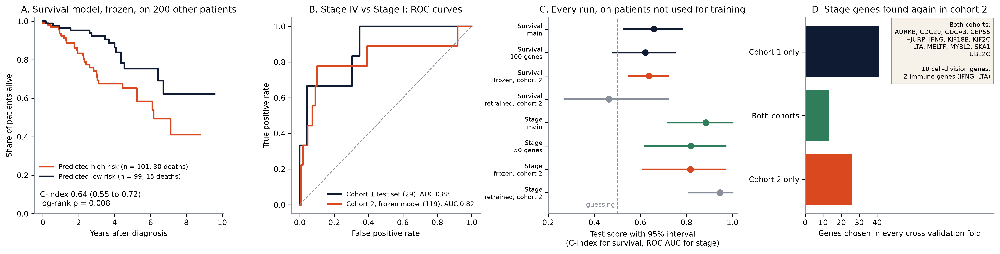

**Figure V1** (drawn from the tables in this repository by [`validation/scripts/make_validation_figure.py`](validation/scripts/make_validation_figure.py)).
- **A:** the frozen survival model on cohort 2.
- **B:** ROC curves of the stage classifier on the cohort-1 test set and on cohort 2.
- **C:** every run's test score with its interval.
- **D:** stage genes chosen in every fold, in one or both cohorts.

**Verdict: both models generalise to new patients from other hospitals. The survival signal is modest but real; the stage signal is strong; the biology agrees with what is known.**

---

## What the lab could do better

Running this example showed two gaps in the machine learning module:
- **The lab cannot yet apply a trained model to another dataset.** The frozen-model test in this repository was done with a short script that loads the model the lab saved. A "predict a new dataset" step would let students run this, the most important validation, inside the lab.
- **The survival model uses the most variable genes, not the genes related to survival.** This is safe (it cannot leak) but wastes the gene budget on genes that vary for other reasons, such as sex. A gene choice inside each fold, as the classifiers already do, would be better.

Both are on the list for the lab.

---

## Limitations

- **One consortium.** Both cohorts come from TCGA, collected and sequenced in the same way. A cohort from another country and platform would be a stronger test. The well-known Japanese cohort E-MTAB-1980 has no survival data in its public ArrayExpress files, so it could not be used.
- **Survival is modest.** A C-index of 0.64 is useful for research, but stage and grade alone reach similar values. The model was not compared with, or combined with, clinical stage.
- **Stage II and III were left out.** The classifier answers an easier question, the two ends of the scale, than the one a doctor faces.
- **The threshold matters.** At 0.5 the classifier misses most stage IV tumours. The ROC curve shows better thresholds, but choosing one on the test set would no longer be a test.
- **Few events and few stage IV tumours.** Cohort 2 has 45 deaths and 9 stage IV tumours, so its intervals are wide.
- **Diagnoses were not filtered.** A few tumours are recorded as renal cell carcinoma NOS or not reported, and one sample in cohort 2 is recorded as transitional cell carcinoma.
- **Importance is not cause.** The genes a model relies on describe the model, not the biology that drives the disease.
- **A teaching example, not clinical advice.** These models are for education and must not be used to diagnose or treat anyone.

---

## Repository structure

```
lsma-lab-machine-learning-kidney-cancer-tcga-kirc/
├── README.md                  this case study
├── LICENSE                    CC BY 4.0
├── assets/
│   └── lsma-lab-kidney-machine-learning-banner.svg   animated banner
├── report/                    the LSMA Analysis Lab's two reports
│   ├── LSMA-Analysis-Lab-report-kidney-cancer-survival-model.pdf / .html
│   └── LSMA-Analysis-Lab-report-kidney-cancer-stage-model.pdf / .html
├── figures/                   key figures, PNG (300 dpi) and vector PDF
│   ├── 01-03  survival model
│   ├── 04-10  stage classifier
│   └── qc-pca-*  follow-up, class sizes, PCA
├── results/                   summary tables (tab-separated)
│   ├── survival/   model_coefficients, model_comparison, test_metrics, test_predictions, data_split
│   └── stage/      model_comparison, feature_stability, feature_importance, test_metrics, test_predictions, data_split
├── validation/                second cohort, robustness and known biology
│   ├── validation-second-cohort-and-robustness.png / .pdf
│   ├── frozen_models_on_second_cohort.tsv / .json
│   ├── frozen_*_model_second_cohort_predictions.tsv
│   ├── robustness_and_second_cohort_summary.tsv
│   ├── second_cohort_patients.tsv
│   ├── second-cohort-retrained/   the lab's tables for both models on cohort 2
│   ├── robustness/                the lab's tables for the re-runs
│   └── scripts/                   fetch cohort 2, apply the frozen models, draw Figure V1
└── settings/
    └── analysis-settings.json          every parameter and software version
```

## Why we share this analysis

This is one of a series of worked examples from the **LSMA Analysis Lab**, published openly for five reasons:

- **To show what the lab does, on real data.** Each repository takes one public dataset through one lab module, from import to report, and shows every step, figure and setting. Nothing is hidden or polished after the fact: the reports here are the ones the lab produced.
- **To teach a complete analysis, not just a result.** Students see the parts that are usually skipped: quality control, the choice of statistics, an independent validation, and an honest list of limitations.
- **To earn trust by checking known biology first.** These analyses deliberately reproduce findings that are already well established, such as the hypoxia programme and the Warburg switch in kidney cancer. A method that gets the known answers right can be trusted with new questions.
- **To keep testing our own tools.** Every example is a real-world test of the lab. Running public data from start to finish shows what works and what needs fixing, and the fixes go back into the lab for every student. Improvements from this series so far: a more reliable import from NCBI GEO, automatic choice of the right cell-type markers for each tissue in single-cell analysis, and removal of sex-chromosome probes and a more robust DIABLO in multi-omics. This analysis adds two more to the list: predicting a new dataset with a trained model, and a better choice of genes for survival models.
- **To make the work open and repeatable.** The data are public, every parameter and software version is listed, and diploma students can repeat the same analysis in the lab themselves.

The series follows one cancer, clear cell kidney cancer, through every layer: genes, single cells, DNA methylation, enhancers, mutations, proteins, metabolites and lipids, all layers together, and here machine learning. Each repository links to the others. A second cancer, lung adenocarcinoma, is followed through all of these layers in one [full project](https://github.com/MultiOmics-Intelligence/lsma-lab-full-project-lung-adenocarcinoma).

These examples are for education and must not be used for medical decisions.

## Data source and credits

- **Data:** The Cancer Genome Atlas (TCGA-KIRC), open-access RNA-seq gene counts and clinical data from the [NCI Genomic Data Commons](https://portal.gdc.cancer.gov/projects/TCGA-KIRC), under the [GDC data use policies](https://gdc.cancer.gov/access-data/data-access-processes-and-tools). No raw data are copied into this repository.
- **Reference studies:**
  - Cancer Genome Atlas Research Network. Comprehensive molecular characterization of clear cell renal cell carcinoma. *Nature* 2013;499:43–49.
  - Brooks SA, Brannon AR, Parker JS, et al. ClearCode34: a prognostic risk predictor for localized clear cell renal cell carcinoma. *European Urology* 2014;66:77–84.
  - Li B, Qiu B, Lee DSM, et al. Fructose-1,6-bisphosphatase opposes renal carcinoma progression. *Nature* 2014;513:251–255.
  - Şenbabaoğlu Y, Gejman RS, Winer AG, et al. Tumor immune microenvironment characterization in clear cell renal cell carcinoma identifies prognostic and immunotherapeutically relevant messenger RNA signatures. *Genome Biology* 2016;17:231.
- **Methods:**
  - Pedregosa et al., *Journal of Machine Learning Research* 2011 (scikit-learn)
  - Davidson-Pilon, *Journal of Open Source Software* 2019 (lifelines)
  - Harrell et al., *Statistics in Medicine* 1996 (concordance index)
  - Ambroise and McLachlan, *PNAS* 2002 (selection bias when genes are chosen outside cross-validation)
  - Ojala and Garriga, *Journal of Machine Learning Research* 2010 (permutation tests for classifiers)
- **Companion analyses** (same cancer):
  - [bulk RNA-seq](https://github.com/MultiOmics-Intelligence/lsma-lab-bulk-rnaseq-kidney-cancer-tcga-kirc)
  - [single-cell RNA-seq](https://github.com/MultiOmics-Intelligence/lsma-lab-single-cell-kidney-cancer-ccrcc)
  - [DNA methylation](https://github.com/MultiOmics-Intelligence/lsma-lab-dna-methylation-kidney-cancer-tcga-kirc)
  - [active enhancers](https://github.com/MultiOmics-Intelligence/lsma-lab-chip-seq-kidney-cancer-enhancers)
  - [somatic mutations](https://github.com/MultiOmics-Intelligence/lsma-lab-somatic-mutations-kidney-cancer-tcga-kirc)
  - [proteomics](https://github.com/MultiOmics-Intelligence/lsma-lab-proteomics-kidney-cancer-cptac)
  - [metabolomics](https://github.com/MultiOmics-Intelligence/lsma-lab-metabolomics-kidney-cancer)
  - [lipidomics](https://github.com/MultiOmics-Intelligence/lsma-lab-lipidomics-kidney-cancer)
  - [multi-omics](https://github.com/MultiOmics-Intelligence/lsma-lab-multi-omics-kidney-cancer-tcga-kirc)

## Run it yourself

Diploma students of the London School of Multiomics & AI can repeat this analysis in the **LSMA Analysis Lab**:
1. **Public data** → TCGA → *TCGA-KIRC*: import RNA-seq, primary tumours, 200 samples.
2. Run **Machine learning** with task *survival* (`survival_days`, event `vital_status` = Dead).
3. Run it again with task *classification* (`stage`, Stage IV against Stage I), comparing several models.

Find out more about the diplomas at [lsma.co.uk](https://lsma.co.uk).

## Licence

The text, figures and tables in this repository are shared under [Creative Commons Attribution 4.0 (CC BY 4.0)](https://creativecommons.org/licenses/by/4.0/): you may reuse them with credit to the London School of Multiomics & AI. TCGA data remain under their own terms.

---

**The LSMA Team**, Analysis Lab, London School of Multiomics & AI


